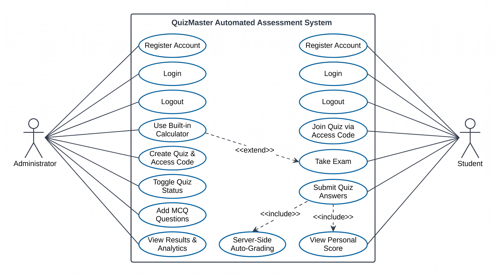
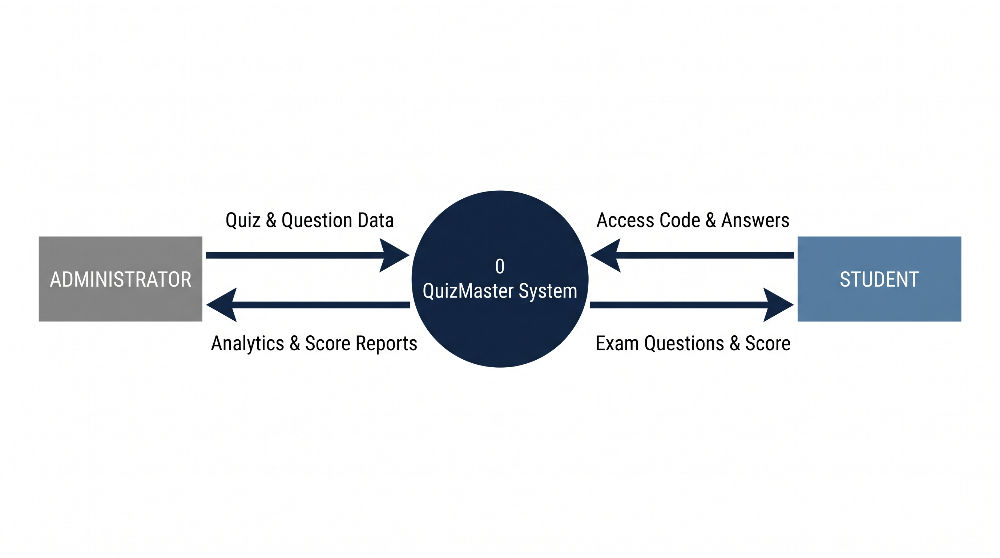
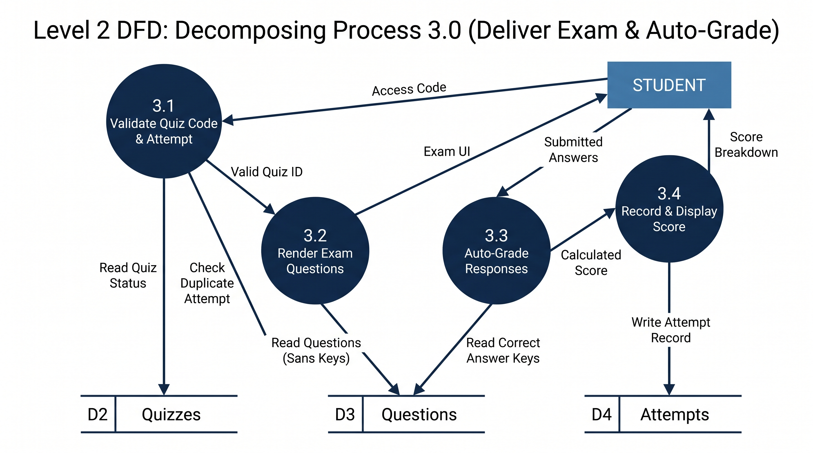
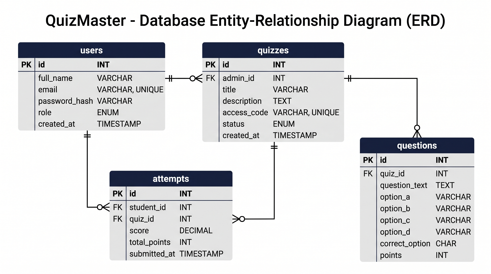

# System Analysis & Modeling Diagrams — QuizMaster
**Project:** QuizMaster — Automated Assessment & Analytics System  
**Jira Issue:** QM-6  
**Epic:** Epic 1 — System Analysis, Architecture & Database Design  
**Author:** Abdalrahman  

---

## 1. UML Use Case Diagram
Illustrates the system boundary, actors (`Administrator` and `Student`), functional use cases, and `<<include>>` / `<<extend>>` dependencies.

---

## 2. Level 0 Data Flow Diagram (Context Diagram)
Models the entire system as a single central process (`Process 0`), defining external entities and high-level input/output data flows.

---

## 3. Level 1 Data Flow Diagram (Process Decomposition)
Decomposes `Process 0` into four core functional processes (`1.0` to `4.0`) interacting with four persistent data stores (`D1` to `D4`).

el-1-dfd.png)

---

## 4. Level 2 Data Flow Diagram (Process 3.0 Decomposition)
Provides a granular breakdown of `Process 3.0 (Deliver Exam & Auto-Grade)` into sub-processes `3.1` through `3.4` to enforce single-attempt validation and server-side grading.

## 5. MySQL Entity-Relationship Diagram (ERD)
